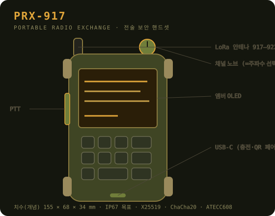

# PRX-917

**인터넷·기지국 없이 동작하는 1:1 종단간 암호화 텍스트 무전기.**
오프그리드 무선(LoRa / Wi-Fi Direct / MultipeerConnectivity) 위에 Double Ratchet 보안을 얹었다.
군용 장비를 분석·복제하지 않고, 공개 암호 기술만으로 "도청 불가·변조 불가·기지국 불필요"라는
전술 무전기의 핵심 가치를 재현하는 것이 목표다.

---

## 🔗 라이브 데모 (브라우저에서 바로 열기)

설치·로그인 없이 인터랙티브 버전을 바로 체험할 수 있다.

| 데모 | 설명 | 열기 |
|---|---|---|
| 🛰 하드웨어 3D 컨셉 | 러기드 핸드셋 3D 뷰 · 평면도 · 사양 (드래그로 회전) | **[열기 ›](https://claude.ai/artifact/DoyZZDnrNL3j2Vr6ASWRhV?sk=evS7C35cy5tOwU76yD5Ymg)** |
| 📱 앱 UI 목업 | 7화면 흐름: 잠금 · 채널 · 탐색 · 안전번호 · 채팅 · 페어링 · 설정 | **[열기 ›](https://claude.ai/artifact/3eqwxyMdJUwBUu2mmthXnr?sk=Jlzx1ZH7sGGtZeuoQ5d52g)** |

> 저장소의 `hardware/` · `ui/` 파일을 클론해 브라우저로 열어도 동일하게 동작한다.

---

## 이름의 의미

| 요소 | 뜻 |
|---|---|
| **PRX** | **P**ortable **R**adio e**X**change — 휴대형 무전 교신기. 군 제식명 `AN/PRC` 계열의 느낌을 살린 오마주이되, 실제 제식명과는 무관한 독자 명칭. |
| **917** | 국내 LoRa **ISM 대역의 시작 주파수 917MHz**. 합법적으로 쓸 수 있는 주파수를 이름에 새겼다. |

> PRC-999K 같은 군용 무전기에서 영감을 받았지만, 그 장비의 주파수 도약·암호 체계를
> 모방하거나 분석하지 않는다. "쓰기 쉽지만 보안이 우수한 무전기"라는 **목표**만 공유한다.

---

## 특징

| | |
|---|---|
| 📡 **오프그리드** | 인터넷·통신사·기지국 없이 기기 간 직접 통신 |
| 🔒 **종단간 암호화** | X25519 · Double Ratchet · ChaCha20-Poly1305 |
| 🔁 **전방향 비밀성** | 메시지마다 키 교체 — 한 번 털려도 과거/미래 안전 |
| 🪪 **중간자 방어** | 안전번호(safety number) 양측 대조 |
| 📻 **무전기 UX** | 채널 선택 · 호출 · 안전번호 확인 |
| 🤝 **크로스플랫폼** | 하나의 Rust 코어를 iOS(Swift)·Android(Kotlin)가 공유 |

---

## 저장소 구조

```
PRX-917/
├─ README.md                 이 문서
├─ LICENSE
├─ docs/
│   ├─ ARCHITECTURE.md        아키텍처 · 위협 모델 · 보안 설계
│   └─ TRANSPORT.md           오프그리드 전송 계층 설계
├─ crypto_core/              Rust 공유 암호 코어 (iOS/Android 공용)
│   ├─ src/
│   │   ├─ lib.rs             신원 · 안전번호 · X3DH-lite · AEAD
│   │   ├─ session.rs         Double Ratchet (vodozemac)
│   │   ├─ api.rs             공개 API + 영구저장(pickle)
│   │   └─ ffi.rs             UniFFI 노출 래퍼
│   └─ bindings/             생성된 Swift·Kotlin 바인딩
├─ transport/
│   ├─ android/NearbyTransport.kt     Nearby Connections 전송
│   └─ ios/MultipeerTransport.swift   MultipeerConnectivity 전송
├─ apps/
│   ├─ android/              ✅ 빌드되는 앱 (Kotlin + Compose) → app-debug.apk
│   └─ ios/                  SwiftUI 앱 소스 (빌드는 macOS/Xcode 필요)
├─ ui/
│   └─ PRX-917-ui-mockup.html  인터랙티브 UI 목업(7화면)
└─ hardware/
    └─ PRX-917-concept.html   러기드 핸드셋 3D/평면도 컨셉
```

## 플랫폼 앱

| 플랫폼 | 상태 | 빌드 |
|---|---|---|
| **Android** | ✅ 디버그 APK 빌드 성공 (crypto_core .so 임베드) | 이 저장소에서 `apps/android` → [가이드](apps/android/README.md) |
| **iOS** | 소스·CI 준비 완료 | macOS/Xcode 또는 GitHub Actions → [가이드](apps/ios/README.md) |

> Android ↔ iOS 는 서로 다른 오프그리드 전송(Nearby vs Multipeer)이라 현재는 같은 플랫폼끼리만 교신한다.

---

## 빠른 시작

### 요구 사항 (Windows)
Rust(GNU 툴체인) + mingw-w64. 컴파일 링커(`dlltool`/`gcc`)를 위해 mingw `bin`을 PATH에 넣어야 한다.

```powershell
# 1) Rust (GNU) 설치
winget install Rustlang.Rustup
rustup toolchain install stable-x86_64-pc-windows-gnu
rustup default stable-x86_64-pc-windows-gnu

# 2) mingw-w64 (WinLibs) 설치
winget install BrechtSanders.WinLibs.POSIX.UCRT

# 3) PATH에 mingw bin 추가 (세션마다)
$mingw = "$env:LOCALAPPDATA\Microsoft\WinGet\Packages\BrechtSanders.WinLibs.POSIX.UCRT_Microsoft.Winget.Source_8wekyb3d8bbwe\mingw64\bin"
$env:PATH = "$mingw;$env:PATH"
```

### 빌드 & 테스트
```powershell
cd crypto_core
cargo test
```
현재 **테스트 23건 통과** (lib 8 · session 4 · api 7 · ffi 4).

---

## 사용법 (공개 API)

핵심 흐름 — **수신자가 프리키를 공개**하고, **발신자가 세션을 열어 첫 메시지를 보낸다**.

### Rust
```rust
use crypto_core::api::{Identity, SecureSession};

// 수신자(Bob): 신원 생성 + 프리키 발행
let mut bob = Identity::generate();
let bob_prekey = bob.generate_prekey().unwrap();   // QR 등으로 공개
let bob_id = bob.public_key();

// 발신자(Alice): 세션 시작 + 첫 메시지
let alice = Identity::generate();
let (mut a_sess, wire) = alice
    .start_session(&bob_id, &bob_prekey, "작전 개시".as_bytes())
    .unwrap();                                     // wire → 전송 계층으로

// 수신자: 세션 수락 + 복호화
let (mut b_sess, first) = bob.accept_session(&alice.public_key(), &wire).unwrap();
assert_eq!(first, "작전 개시".as_bytes());

// 중간자 방어: 양측이 같은 안전번호인지 대조
let sn = alice.safety_number_with(&bob.public_key()).unwrap();
```

### Swift (iOS)
```swift
let bob = Identity.generate()
let bobPrekey = try bob.generatePrekey()
let alice = Identity.generate()

let aSess = try alice.openSession(theirIdB64: bob.publicKey(), theirPrekeyB64: bobPrekey)
let wire  = try aSess.encrypt(plaintext: Data("작전 개시".utf8))   // 전송 계층으로

let bSess = try bob.acceptSession(theirIdB64: alice.publicKey(), wire: wire)
let first = bSess.takeFirstMessage()               // "작전 개시"
```

### Kotlin (Android)
```kotlin
val bob = Identity.generate()
val bobPrekey = bob.generatePrekey()
val alice = Identity.generate()

val aSess = alice.openSession(bob.publicKey(), bobPrekey)
val wire  = aSess.encrypt("작전 개시".toByteArray())      // 전송 계층으로

val bSess = bob.acceptSession(alice.publicKey(), wire)
val first = bSess.takeFirstMessage()
```

### 영구저장 (앱 재시작 대비)
```
save(pickleKey) → 암호화 문자열 → Keychain(iOS) / Keystore(Android)에 저장
restore(문자열, pickleKey) → 복원
```

---

## 크로스플랫폼 바인딩 재생성 (UniFFI)
```powershell
cd crypto_core
cargo build
cargo run --bin uniffi-bindgen -- generate --library target\debug\crypto_core.dll --language swift  --out-dir bindings\swift
cargo run --bin uniffi-bindgen -- generate --library target\debug\crypto_core.dll --language kotlin --out-dir bindings\kotlin
```

---

## 전송 계층

`crypto_core`가 만든 **wire 문자열**을 인터넷 없이 폰↔폰 전달한다. 자세한 설계는 [`docs/TRANSPORT.md`](docs/TRANSPORT.md).

- **채널 = 주파수 선택**: `prx917.chN`(Android) / `prx917-chN`(iOS) 식별자로 전환
- **프레임 태그**: `K`(프리키) · `P`(PreKey wire) · `N`(일반 wire)
- 전송 경로가 도청돼도 내용은 Double Ratchet로 보호 — 전송 계층은 바이트 왕복만 담당

> Android 전송은 `apps/android` 앱에 통합되어 **APK로 빌드된다**. iOS 전송은 `apps/ios`에
> 통합돼 있으나 빌드에 macOS/Xcode가 필요하다.

---

## 하드웨어 컨셉 (3D)



위는 정적 미리보기(SVG). **회전 가능한 3D 뷰**는 👉 **[라이브 데모 열기](https://claude.ai/artifact/DoyZZDnrNL3j2Vr6ASWRhV?sk=evS7C35cy5tOwU76yD5Ymg)**
또는 [`hardware/PRX-917-concept.html`](hardware/PRX-917-concept.html)을 브라우저로 직접 열면 동작한다
(GitHub는 인터랙티브 HTML을 렌더링하지 않는다). 소프트웨어 중심 프로젝트이므로 하드웨어는 개념 시각화 단계다.

**화면 구성**
- **3D 뷰** — 국방색 섀시·코요테 범퍼·앰버 OLED·필드그린 노브/PTT의 전술 무전기 룩
- **전면 평면도** — 부품 번호 콜아웃(안테나·채널노브·OLED·PTT·키패드·보안요소 등) + 치수선(155×68mm)
- **좌측면도 · 개념 사양** — 두께 34mm, 917–923.5MHz, X25519·ChaCha20, ATECC608, IP67(목표)

**조작법 (3D 뷰)**
- **드래그** — 기기 회전 (손 떼면 자동 회전)
- 터치/마우스 모두 지원, `prefers-reduced-motion` 시 자동 회전 off

## 앱 조작법 (UI 목업 + 실제 앱 공통 흐름)

인터랙티브 목업: 👉 **[라이브 데모 열기](https://claude.ai/artifact/3eqwxyMdJUwBUu2mmthXnr?sk=Jlzx1ZH7sGGtZeuoQ5d52g)**
또는 [`ui/PRX-917-ui-mockup.html`](ui/PRX-917-ui-mockup.html) (브라우저로 열어 눌러보기).
실제 Android 앱(`apps/android`)도 동일한 흐름을 따른다.

```
① 잠금 해제   얼굴/지문(생체인증) 또는 기기 비밀번호
② 채널 선택   CH 1~8 중 하나 탭 (= 통신망 선택). 같은 채널끼리만 교신
③ 탐색/호출   주변 국 자동 발견 → 상대 선택(또는 수신 호출 수락)
④ 안전번호    양 기기 화면의 숫자가 같은지 대조 → "일치·확인" (중간자 차단)
⑤ 교신        암호 채팅. 링크 끊기면 "재연결" 버튼
```
- **하단 탭바**: 무전 · 페어링 · 설정
- **페어링 탭**: 내 신원 QR 표시 / 상대 QR 스캔(카메라)
- **설정 탭**: 콜사인 · 채널 · 토글(생체잠금·자동삭제·알림음) · 신원키 재생성

---

## 로드맵

- [x] 보안 코어 (신원 · Double Ratchet · AEAD · 저장) — 테스트 23, 안전번호 ~100비트
- [x] UniFFI 바인딩 (Swift / Kotlin)
- [x] 전송 계층 (Nearby Connections / MultipeerConnectivity)
- [x] UI 목업 (7화면 · 생체잠금)
- [x] 하드웨어 컨셉 (3D/평면도)
- [x] **Android 앱 빌드** (crypto_core .so 임베드 → app-debug.apk)
- [x] iOS 앱 소스 + 클라우드 CI
- [ ] Android UI 다듬기 (목업 수준 디자인·QR 페어링·설정·재연결)
- [ ] BiometricPrompt / Keystore 생체 게이팅 실연동
- [ ] iOS 네이티브 빌드 (macOS/CI) · 실기기 통합 테스트
- [ ] Android ↔ iOS 크로스 통신 (공통 BLE 전송)

---

## 보안 · 법적 고지

- **설계 원칙**: 핵심 암호는 직접 구현하지 않고 감사 완료된 라이브러리(vodozemac)를 사용한다.
  직접 작성한 코드는 조립·검증·저장에 한정한다.
- **주파수 규정**: 국내 LoRa는 917–923.5MHz ISM 대역·출력·점유시간(duty cycle) 규정을 준수해야 한다.
- **범위**: 군용 장비의 분석·복제·주파수 도약 모방은 하지 않는다. 공개 표준·오픈소스 암호만 사용한다.
- 이 저장소에는 개인키 등 비밀값이 포함되어서는 안 된다(암호화 pickle은 OS 보안저장소에 보관).

## 라이선스

MIT License — [`LICENSE`](LICENSE) 참고.
